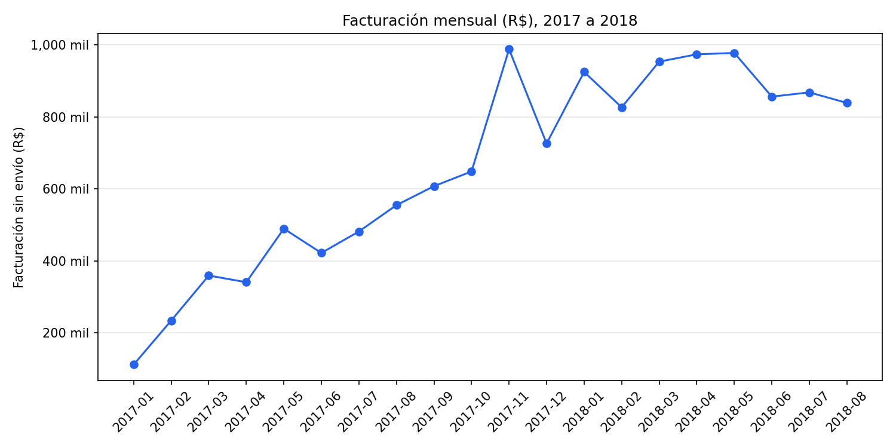
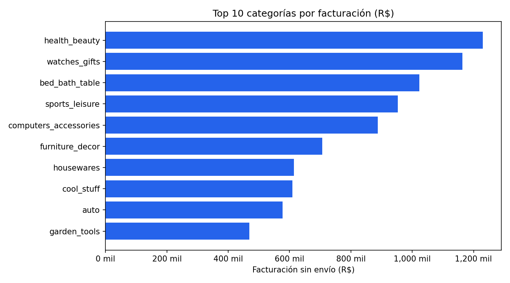
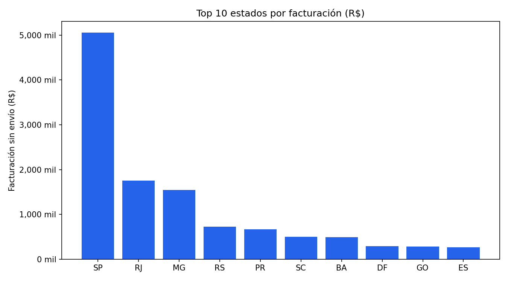
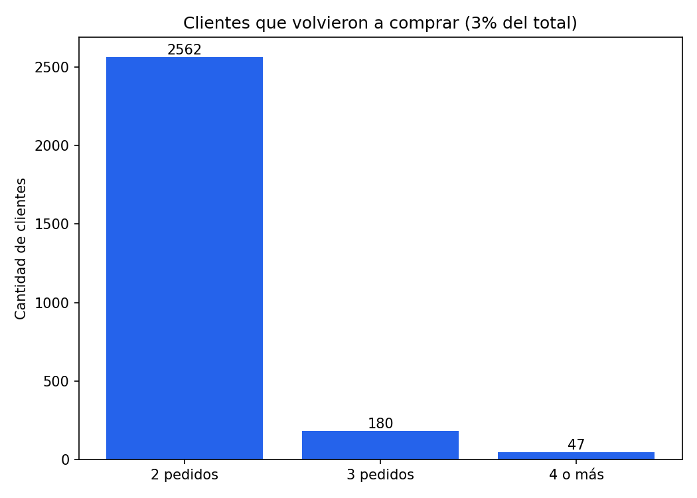
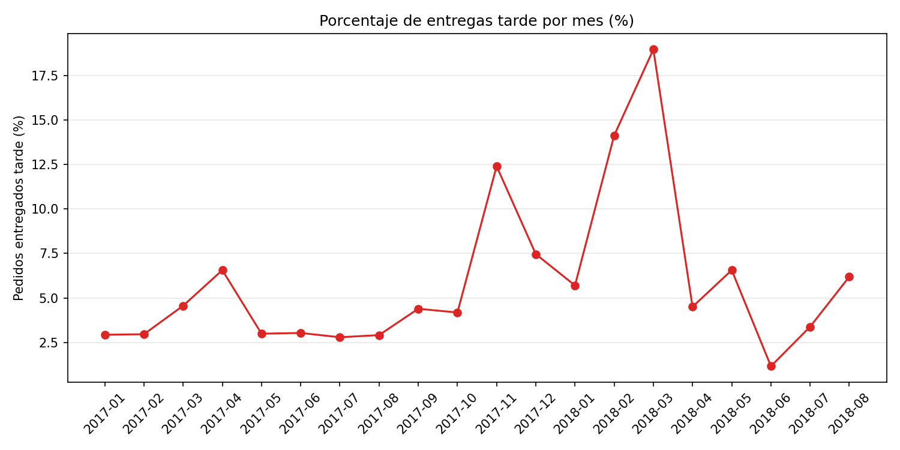
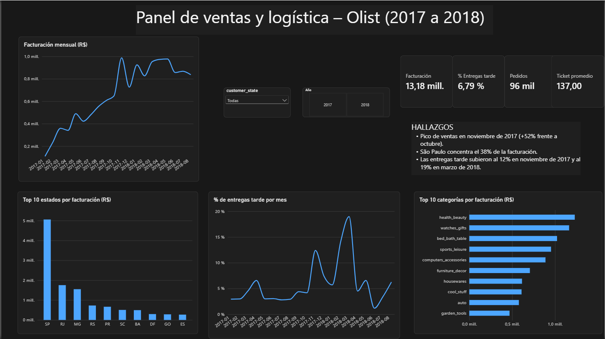
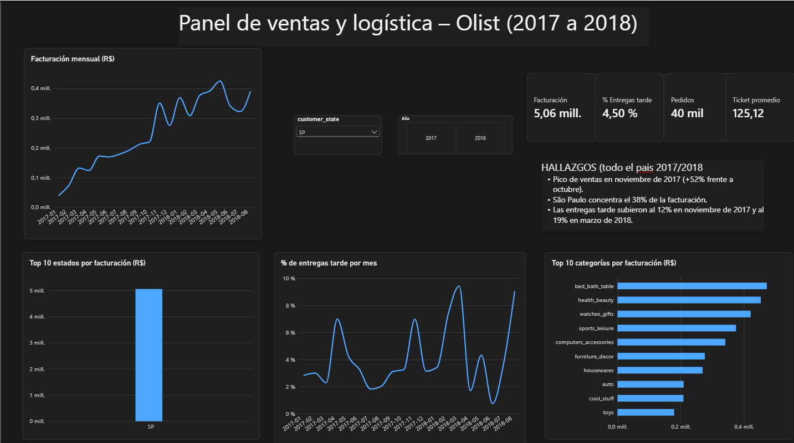

# Análisis de ventas de e-commerce (Olist) con SQL

Análisis de datos reales de un marketplace brasileño para responder cinco
preguntas de negocio con SQL. El objetivo es pasar de los datos crudos a
conclusiones claras que sirvan para tomar decisiones.

- **Dataset:** [Brazilian E-Commerce Public Dataset by Olist](https://www.kaggle.com/datasets/olistbr/brazilian-ecommerce) (Kaggle)
- **Herramientas:** SQL (SQLite), DB Browser for SQLite, Python (pandas y Matplotlib) para los gráficos y Power BI para el dashboard
- **Autor:** Santiago, estudiante avanzado de Sistemas de Información de las Organizaciones (UBA) · [Fiverr](https://pro.fiverr.com/s/ZooWgRa) · [LinkedIn](https://www.linkedin.com/in/santiago-ziccardi-670abb373)

> **Notas:** los montos están en reales brasileños (R$) y no incluyen el costo de envío.
> Salvo que se indique otra cosa, se analizan pedidos entregados (`delivered`) entre
> enero de 2017 y agosto de 2018; se excluyen los meses de los extremos del dataset
> por tener datos incompletos. El dataset no se incluye en este repositorio: se
> descarga desde Kaggle.

## Resumen de hallazgos

- **Ventas:** crecieron durante 2017 hasta un máximo en noviembre (+52% frente a octubre), y en 2018 se mantuvieron en un nivel alto y estable.
- **Categorías:** las 10 principales concentran el 62,5% de la facturación y ninguna supera el 10%: las ventas están repartidas.
- **Geografía:** São Paulo, Rio de Janeiro y Minas Gerais concentran el 63,4% de la facturación. El negocio depende mucho de São Paulo (38,4%).
- **Recompra:** solo el 3,0% de los clientes volvió a comprar.
- **Logística:** el 6,8% de los pedidos llegó tarde, con picos en noviembre de 2017 y entre febrero y marzo de 2018. Los pedidos tardíos tienen un puntaje de reseña de 2,27 contra 4,29 de los puntuales.

## Estructura del repositorio

- `queries/`: las consultas SQL de cada pregunta.
- `results/`: los resultados en CSV y los gráficos en PNG.
- `dashboard/`: capturas del panel interactivo de Power BI.
---
## Cómo reproducir el análisis

1. Descargar el dataset desde Kaggle (link arriba).
2. Importar los CSV a una base SQLite (por ejemplo con DB Browser for SQLite), usando
   como nombre de tabla el nombre del archivo: `olist_orders_dataset`,
   `olist_order_items_dataset`, `olist_customers_dataset`, `olist_products_dataset`,
   `olist_order_reviews_dataset` y `product_category_name_translation`.
3. Ejecutar las consultas de la carpeta `queries/`.


   - `graficos.py`: script de Python que genera los gráficos de la carpeta `results/`.
## 1. ¿Cuánto se vendió por mes y cómo evolucionó?

**Consulta:** [`queries/01_ventas_por_mes.sql`](queries/01_ventas_por_mes.sql)

<details>
<summary>Ver la consulta SQL</summary>

```sql
SELECT
    strftime('%Y-%m', o.order_purchase_timestamp) AS mes,
    ROUND(SUM(i.price), 2) AS facturacion_sin_envio,
    COUNT(DISTINCT o.order_id) AS total_pedidos,
    ROUND(SUM(i.price) / COUNT(DISTINCT o.order_id), 2) AS ticket_promedio
FROM olist_orders_dataset o
JOIN olist_order_items_dataset i ON o.order_id = i.order_id
WHERE o.order_status = 'delivered'
    AND o.order_purchase_timestamp >= '2017-01-01'
    AND o.order_purchase_timestamp < '2018-09-01'
GROUP BY mes
ORDER BY mes ASC;
```

</details>

**Resultado:** [`results/results01.csv`](results/results01.csv)



**Conclusión:**
La facturación creció durante 2017: pasó de R$ 111.798 en enero a R$ 648.248
en octubre. El máximo de todo el período fue en noviembre de 2017, con
R$ 987.765, un 52% más que en octubre. El pico coincide con el Black Friday.

El salto de noviembre vino del volumen y no del precio: los pedidos pasaron
de 4.478 a 7.289 (+63%), mientras que el ticket promedio bajó de R$ 144,76 a
R$ 135,51. A lo largo de 2017 el ticket promedio se mantuvo estable, entre
R$ 124 y R$ 149. En 2018 las ventas se mantuvieron en un nivel alto y estable,
entre R$ 826 mil y R$ 978 mil por mes: por encima de los niveles previos a
noviembre de 2017, pero sin volver a superar su pico.

**Recomendación:** reforzar el stock, la logística y la atención al cliente
de cara a noviembre, que es el mes de mayor demanda.

---

## 2. ¿Cuáles son las 10 categorías que más facturan?

**Consulta:** [`queries/02_10.productos.mas.vendidos.sql`](queries/02_10.productos.mas.vendidos.sql)

<details>
<summary>Ver la consulta SQL</summary>

```sql
SELECT
    COALESCE(t.product_category_name_english, p.product_category_name, 'unknown') AS categoria,
    ROUND(SUM(i.price), 2) AS facturacion_sin_envio,
    COUNT(DISTINCT o.order_id) AS total_pedidos,
    ROUND(SUM(i.price) / COUNT(DISTINCT o.order_id), 2) AS facturacion_por_pedido,
    ROUND(SUM(i.price) * 100.0 / SUM(SUM(i.price)) OVER (), 2) AS porcentaje_del_total
FROM olist_orders_dataset o
JOIN olist_order_items_dataset i ON o.order_id = i.order_id
JOIN olist_products_dataset p ON i.product_id = p.product_id
LEFT JOIN product_category_name_translation t
    ON p.product_category_name = t.product_category_name
WHERE o.order_status = 'delivered'
    AND o.order_purchase_timestamp >= '2017-01-01'
    AND o.order_purchase_timestamp < '2018-09-01'
GROUP BY categoria
ORDER BY facturacion_sin_envio DESC
LIMIT 10;
```

</details>

**Resultado:** [`results/results02.csv`](results/results02.csv)



**Conclusión:**
Las diez categorías más vendidas concentran el 62,5% de la facturación (sin
envío), y ninguna supera el 10% del total, por lo que las ventas están
repartidas. Salud y belleza lidera con R$ 1,23 millones (9,3%), seguida por
relojes y regalos (R$ 1,16 millones) y cama, baño y mesa (R$ 1,02 millones).

Los perfiles son distintos: relojes y regalos factura casi lo mismo que salud
y belleza con un 36% menos de pedidos, porque cada pedido vale cerca de un 50%
más (R$ 212 contra R$ 143). Cama, baño y mesa, en cambio, vende por volumen:
tiene el mayor número de pedidos (9.267) y un valor por pedido bajo (R$ 110).

**Recomendación:** cuidar el stock y la promoción de las categorías líderes y
evaluar la logística de las de mayor valor por pedido, donde cada entrega
fallida cuesta más.

---

## 3. ¿Qué estados concentran más ventas?

**Consulta:** [`queries/03_ventas.por.estado.sql`](queries/03_ventas.por.estado.sql)

<details>
<summary>Ver la consulta SQL</summary>

```sql
SELECT
    c.customer_state AS estado,
    ROUND(SUM(i.price), 2) AS facturacion_sin_envio,
    COUNT(DISTINCT o.order_id) AS total_pedidos,
    COUNT(DISTINCT c.customer_unique_id) AS clientes_unicos,
    ROUND(SUM(i.price) / COUNT(DISTINCT o.order_id), 2) AS facturacion_por_pedido,
    ROUND(SUM(i.price) * 100.0 / SUM(SUM(i.price)) OVER (), 2) AS porcentaje_del_total
FROM olist_orders_dataset o
JOIN olist_order_items_dataset i ON o.order_id = i.order_id
JOIN olist_customers_dataset c ON o.customer_id = c.customer_id
WHERE o.order_status = 'delivered'
    AND o.order_purchase_timestamp >= '2017-01-01'
    AND o.order_purchase_timestamp < '2018-09-01'
GROUP BY c.customer_state
ORDER BY facturacion_sin_envio DESC
LIMIT 10;
```

Consulta de verificación (gasto por pedido en todos los estados con al menos 100 pedidos):

```sql
SELECT
    c.customer_state AS estado,
    COUNT(DISTINCT o.order_id) AS total_pedidos,
    ROUND(SUM(i.price) / COUNT(DISTINCT o.order_id), 2) AS facturacion_por_pedido
FROM olist_orders_dataset o
JOIN olist_order_items_dataset i ON o.order_id = i.order_id
JOIN olist_customers_dataset c ON o.customer_id = c.customer_id
WHERE o.order_status = 'delivered'
    AND o.order_purchase_timestamp >= '2017-01-01'
    AND o.order_purchase_timestamp < '2018-09-01'
GROUP BY c.customer_state
HAVING COUNT(DISTINCT o.order_id) >= 100
ORDER BY facturacion_por_pedido DESC;
```

</details>

**Resultado:** [`results/results03.csv`](results/results03.csv)



**Conclusión:**
Tres estados concentran el 63,4% de la facturación (sin envío): São Paulo
(38,4%), Rio de Janeiro (13,3%) y Minas Gerais (11,8%). Con los estados del sur
(Rio Grande do Sul, Paraná y Santa Catarina) y Espírito Santo, la región
sudeste-sur llega al 79,8%. El negocio depende mucho de São Paulo, pero el
61,6% restante viene de otros estados, lo que indica margen para diversificar.

El gasto por pedido varía poco entre los 10 estados principales (de R$ 125 a
R$ 152). São Paulo, el mayor mercado, tiene el más bajo (R$ 125), y Bahía el
más alto (R$ 152, un 21% más), aunque solo representa el 3,7% de la
facturación. Entre todos los estados con al menos 100 pedidos, Bahía queda en
el puesto 15, por lo que su gasto elevado es relativo al grupo de los diez
mayores mercados. Con estos datos no se puede explicar la diferencia, que
podría deberse a las categorías compradas o a la cantidad de ítems por pedido.

La recompra es muy baja en los diez estados principales: hay solo unos 1,03
pedidos por cliente. Este punto se analiza en la pregunta 4.

**Recomendación:** reducir la dependencia de São Paulo reforzando la presencia
en otros estados, y probar a pequeña escala campañas en los estados de mayor
gasto por pedido antes de invertir en grande.

---

## 4. ¿Qué porcentaje de clientes volvió a comprar?

**Consulta:** [`queries/04_recompra.sql`](queries/04_recompra.sql)

<details>
<summary>Ver las consultas SQL</summary>

Porcentaje de recompra:

```sql
WITH pedidos_por_cliente AS (
    SELECT
        c.customer_unique_id,
        COUNT(DISTINCT o.order_id) AS pedidos
    FROM olist_orders_dataset o
    JOIN olist_customers_dataset c ON o.customer_id = c.customer_id
    WHERE o.order_status = 'delivered'
        AND o.order_purchase_timestamp >= '2017-01-01'
        AND o.order_purchase_timestamp < '2018-09-01'
    GROUP BY c.customer_unique_id
)
SELECT
    COUNT(*) AS clientes_totales,
    SUM(CASE WHEN pedidos >= 2 THEN 1 ELSE 0 END) AS clientes_que_repiten,
    ROUND(SUM(CASE WHEN pedidos >= 2 THEN 1 ELSE 0 END) * 100.0 / COUNT(*), 2) AS porcentaje_recompra,
    ROUND(AVG(pedidos), 3) AS pedidos_promedio_por_cliente
FROM pedidos_por_cliente;
```

Distribución de clientes según cantidad de pedidos:

```sql
WITH pedidos_por_cliente AS (
    SELECT
        c.customer_unique_id,
        COUNT(DISTINCT o.order_id) AS pedidos
    FROM olist_orders_dataset o
    JOIN olist_customers_dataset c ON o.customer_id = c.customer_id
    WHERE o.order_status = 'delivered'
        AND o.order_purchase_timestamp >= '2017-01-01'
        AND o.order_purchase_timestamp < '2018-09-01'
    GROUP BY c.customer_unique_id
)
SELECT pedidos, COUNT(*) AS clientes
FROM pedidos_por_cliente
GROUP BY pedidos
ORDER BY pedidos;
```

</details>

**Resultado:** [`results/results04.csv`](results/results04.csv) y [`results/results04.2.csv`](results/results04.2.csv)



**Conclusión:**
Solo el 3,0% de los clientes volvió a comprar en el período analizado (2.789
de 93.104), con un promedio de 1,03 pedidos por cliente. Entre quienes repiten,
la gran mayoría lo hace una sola vez: 2.562 clientes hicieron 2 pedidos, 180
hicieron 3 y solo 47 (un 0,05% del total) hicieron más de 3.

Esto sugiere que el negocio depende de conseguir clientes nuevos de forma
constante, y que las acciones para que los clientes vuelvan (programas de
fidelización, descuentos para la segunda compra, seguimiento posventa) no están
funcionando o no existen. Con estos datos no se puede saber cuál de las dos
cosas pasa. Como el dataset cubre unos 20 meses, los clientes que compraron por
primera vez cerca del final tuvieron menos tiempo para volver, así que el 3% es
probablemente un piso.

**Recomendación:** probar una campaña dirigida a quienes ya compraron una vez
(por ejemplo, un cupón para la segunda compra) y medir si sube el porcentaje de
recompra antes de invertir en adquirir más clientes.

---

## 5. ¿Cuánto tardan las entregas y cuántos pedidos llegan tarde?

"Tarde" significa que el pedido llegó después de la fecha estimada que se le
prometió al cliente.

**Consulta:** [`queries/05_entregas.sql`](queries/05_entregas.sql)

<details>
<summary>Ver las consultas SQL</summary>

Panorama general:

```sql
SELECT
    COUNT(*) AS pedidos_entregados,
    ROUND(AVG(julianday(order_delivered_customer_date) - julianday(order_purchase_timestamp)), 1) AS dias_promedio_entrega,
    ROUND(AVG(julianday(order_estimated_delivery_date) - julianday(order_purchase_timestamp)), 1) AS dias_promedio_prometido,
    ROUND(MAX(julianday(order_delivered_customer_date) - julianday(order_purchase_timestamp)), 0) AS dias_maximo,
    SUM(CASE WHEN date(order_delivered_customer_date) > date(order_estimated_delivery_date) THEN 1 ELSE 0 END) AS pedidos_tarde,
    ROUND(SUM(CASE WHEN date(order_delivered_customer_date) > date(order_estimated_delivery_date) THEN 1 ELSE 0 END) * 100.0 / COUNT(*), 2) AS porcentaje_tarde
FROM olist_orders_dataset
WHERE order_status = 'delivered'
    AND order_delivered_customer_date IS NOT NULL
    AND order_purchase_timestamp >= '2017-01-01'
    AND order_purchase_timestamp < '2018-09-01';
```

Evolución mes a mes:

```sql
SELECT
    strftime('%Y-%m', order_purchase_timestamp) AS mes,
    COUNT(*) AS pedidos,
    ROUND(AVG(julianday(order_delivered_customer_date) - julianday(order_purchase_timestamp)), 1) AS dias_promedio_entrega,
    ROUND(SUM(CASE WHEN date(order_delivered_customer_date) > date(order_estimated_delivery_date) THEN 1 ELSE 0 END) * 100.0 / COUNT(*), 2) AS porcentaje_tarde
FROM olist_orders_dataset
WHERE order_status = 'delivered'
    AND order_delivered_customer_date IS NOT NULL
    AND order_purchase_timestamp >= '2017-01-01'
    AND order_purchase_timestamp < '2018-09-01'
GROUP BY mes
ORDER BY mes;
```

Relación con las reseñas:

```sql
SELECT
    CASE WHEN date(o.order_delivered_customer_date) > date(o.order_estimated_delivery_date)
         THEN 'Tarde' ELSE 'A tiempo' END AS entrega,
    COUNT(DISTINCT o.order_id) AS pedidos,
    ROUND(AVG(r.review_score), 2) AS puntaje_promedio
FROM olist_orders_dataset o
JOIN olist_order_reviews_dataset r ON o.order_id = r.order_id
WHERE o.order_status = 'delivered'
    AND o.order_delivered_customer_date IS NOT NULL
    AND o.order_purchase_timestamp >= '2017-01-01'
    AND o.order_purchase_timestamp < '2018-09-01'
GROUP BY entrega;
```

</details>

**Resultado:** [`results/results05.csv`](results/results05.csv)



**Conclusión:**
Las entregas tardan en promedio 12,5 días, frente a los 23,6 días prometidos al
cliente, y el 6,8% de los pedidos (6.531 de 96.203) llegó después de la fecha
prometida.

El problema se concentra en dos períodos. En noviembre de 2017, con el pico de
ventas, las entregas tarde subieron del 4,2% al 12,4% y el tiempo promedio de
11,9 a 15,2 días. El peor momento fue entre febrero y marzo de 2018, con 14,1%
y 19,0% de entregas tarde, incluso con un volumen similar al de noviembre, por
lo que el volumen por sí solo no explica los retrasos. Desde abril de 2018 el
porcentaje bajó a entre 1,2% y 6,6%.

Las entregas tardías se asocian con peores reseñas: 2,27 de puntaje promedio
contra 4,29 en las entregas a tiempo (sobre los 95.560 pedidos que tienen
reseña). Con estos datos no se puede probar que la demora sea la causa, pero
el patrón es consistente.

**Recomendación:** reforzar la capacidad logística antes de los meses de mayor
demanda, investigar qué ocurrió entre febrero y marzo de 2018 y monitorear
mensualmente el porcentaje de entregas tarde como indicador clave.

---

## Dashboard interactivo en Power BI

Además del análisis en SQL, armé un panel en Power BI con los mismos datos, para
explorar ventas, categorías, estados y entregas con filtros por estado y año.





-  **Archivo del dashboard:** [descargar olist_dashboard.pbix](https://drive.google.com/file/d/15vA5PhnPtPHBZJ1_KhVyB018yxs1bFJp/view?usp=sharing) (se abre con Power BI Desktop, en Windows)
- Los valores del panel coinciden con los resultados de las consultas SQL
  (facturación de R$ 13,18 millones, 96.211 pedidos, 6,79% de entregas tarde).
  
## Conclusiones generales

1. **Dependencia geográfica:** más de un tercio de la facturación viene de São Paulo, aunque el resto del país suma más del 60%.
2. **Recompra casi nula:** el crecimiento depende de conseguir clientes nuevos todo el tiempo.
3. **Logística en los picos de demanda:** las entregas tarde se disparan en noviembre de 2017 y en el primer trimestre de 2018, y se asocian con peores reseñas.
4. **Oportunidad:** una campaña de segunda compra y un control mensual de entregas tarde son acciones concretas y medibles para empezar.
